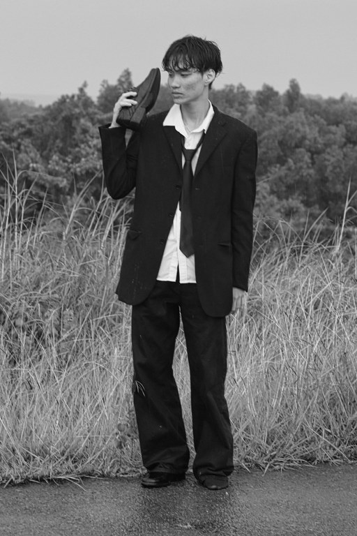
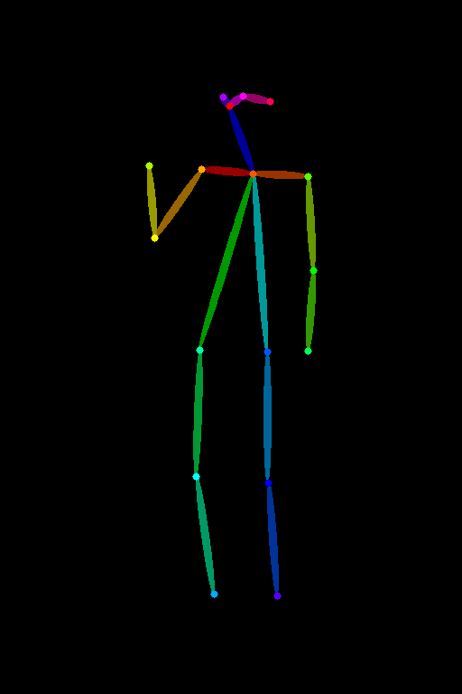
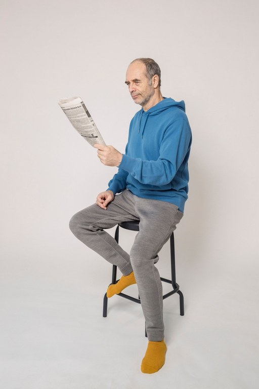
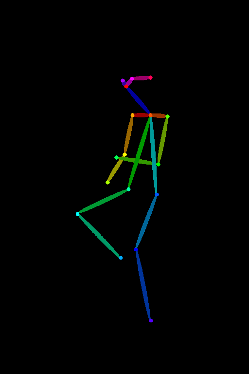
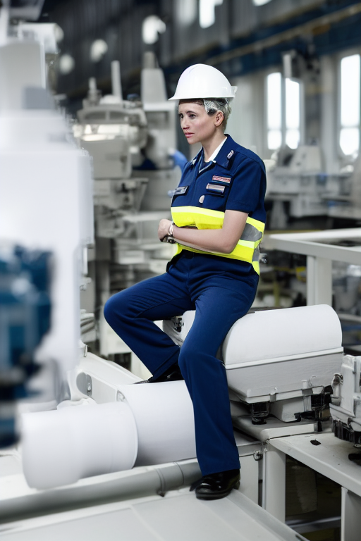
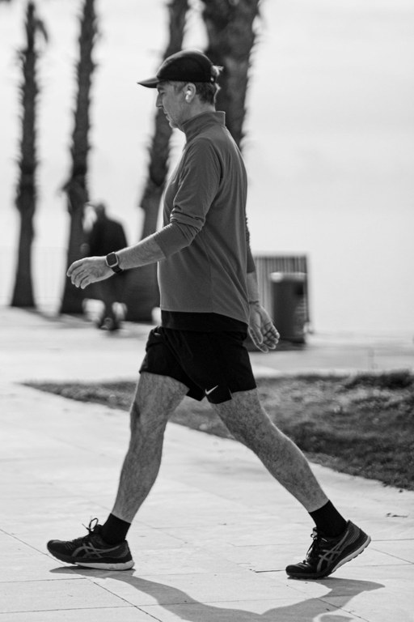
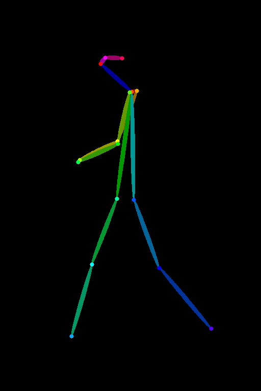
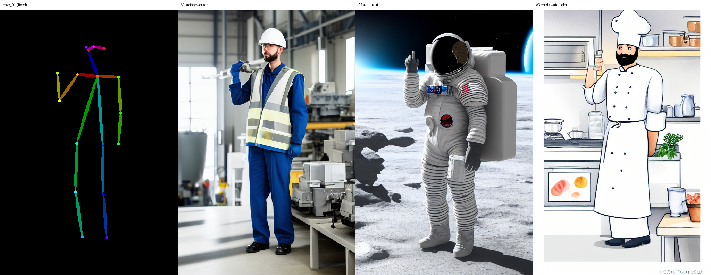
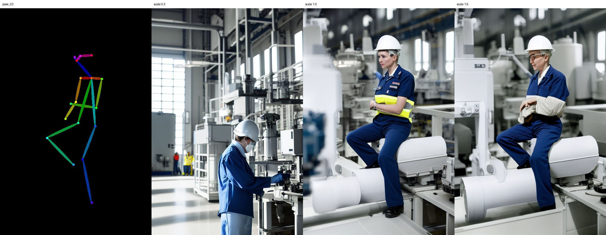

# 원하는 포즈로 이미지 만드는 도구

참조 사진의 **자세(포즈)** 만 가져와서, 같은 자세를 한 다른 인물·장면을 만드는 Colab 튜토리얼입니다.

## 도구 설명
- 참조 사진에서 OpenPose로 관절 위치(뼈대 그림)를 뽑습니다.
- 그 뼈대 그림을 ControlNet 조건으로 넣고, 프롬프트와 함께 이미지를 생성합니다.
- 자세는 참조 사진이, 인물·배경·화풍은 프롬프트가 정합니다.

```
참조 사진 ─(OpenPose)→ 뼈대 그림 ─(ControlNet)─┐
                                             ├→ 같은 자세의 새 이미지
프롬프트 ─────────────────────────────────────┘
```

## 사용법
1. 이 저장소의 `pose_tool.ipynb`를 Colab에서 엽니다. (Colab → 파일 → 노트 열기 → GitHub 탭에 저장소 주소 붙여넣기)
2. `런타임 → 런타임 유형 변경 → T4 GPU`로 바꿉니다.
3. `런타임 → 모두 실행`을 누릅니다. (GPU 확인 → 설치 → 설정 → 모델 로드 → 참조 사진 → 포즈 추출 → 생성 → 실험 → 저장)
4. 참조 사진 3장은 노트 안에 들어 있어 따로 올릴 필요가 없습니다. 다른 사진으로 해 보려면 3번 셀에서 `USE_MY_PHOTOS = True`로 바꿉니다.
5. 마지막 코드 셀이 `samples/`와 `prompts.md`를 zip으로 내려 줍니다.

## 테스트 결과
세 결과 모두 프롬프트는 같은 "공장 작업자"이고 포즈만 다릅니다.

| 참조 사진 | 뽑은 포즈 | 결과 |
|---|---|---|
|  |  |  |
|  |  |  |
|  |  |  |

- 포즈 1: 서서 한 손을 머리 옆으로 든 자세 → 결과: 든 손의 높이, 내린 팔, 모은 두 발까지 맞았습니다. 손에는 구두 대신 공구가 들렸습니다.
- 포즈 2: 높은 의자에 앉아 한쪽 무릎을 올린 자세 → 결과: 앉은 자세와 다리 모양은 맞았고, 신문을 든 팔은 가슴 앞에 모은 모양으로 바뀌었습니다.
- 포즈 3: 옆모습으로 크게 걷는 자세 → 결과: 옆모습과 큰 보폭은 맞았고, 앞으로 내민 다리가 기계 뒤에 가려졌습니다.

같은 포즈·다른 프롬프트 (포즈 1 고정):



포즈 강도 0.3 / 1.0 / 1.6 (포즈 2 고정):



자세한 관찰은 노트 마지막 "실험 기록" 셀에 있습니다.

## 한계
- 뼈대에는 손가락과 손에 든 물건 정보가 없어서 손 모양과 소품은 통제되지 않았습니다.
- 포즈 조건은 자세만 잡아 줍니다. 같은 프롬프트여도 포즈를 바꾸면 인물의 얼굴과 성별이 달라졌습니다.
- 포즈 강도가 낮으면(0.3) 포즈가 무시되고, 높으면(1.6) 그림이 어색해졌습니다.
- 화면 안 글자는 낙서처럼 나왔습니다.

## 사용한 모델과 라이선스
| 역할 | 모델 | 라이선스 |
|---|---|---|
| 포즈 추출 | OpenPose (`controlnet_aux`) | – |
| 포즈 조건 | `lllyasviel/control_v11p_sd15_openpose` (ControlNet v1.1) | OpenRAIL |
| 이미지 생성 | Stable Diffusion v1.5 | CreativeML OpenRAIL-M |

수업 실습 모델인 FLUX.2-klein 4B에는 아직 공식 ControlNet이 없어서, 포즈 ControlNet이 안정적으로 지원되고 무료 T4에서 도는 Stable Diffusion v1.5를 사용했습니다. 포즈 추출 → 조건 입력 → 생성이라는 흐름은 같습니다.

## 참조 사진 출처
사람 주변만 잘라 512×768 크기로 맞춰 사용했습니다.
- ref_01 (한 손을 든 사람): Pexels, dxaxoxfz
- ref_02 (의자에 앉은 사람): 출처 추가 예정
- ref_03 (걷는 사람): Pexels, Ayşegül Aytören

## 폴더 구조
```
pose-image-tool/
├── README.md
├── pose_tool.ipynb      # Colab 튜토리얼 노트
├── prompts.md           # 테스트에 쓴 프롬프트 모음
└── samples/
    ├── ref_01~03.png    # 참조 사진 (자세의 출처)
    ├── pose_01~03.png   # 참조 사진에서 뽑은 포즈(뼈대) 이미지
    ├── output_01~03.png # 같은 자세로 만든 결과 (같은 프롬프트, 다른 포즈)
    ├── expA_*.png       # 실험 A: 같은 포즈, 다른 프롬프트
    ├── expC_*.png       # 실험 C: 포즈 강도 바꾸기
    ├── grid_*.png       # 나란히 비교한 그림
    └── run_log.json     # 이미지별 프롬프트·시드·설정 기록
```
